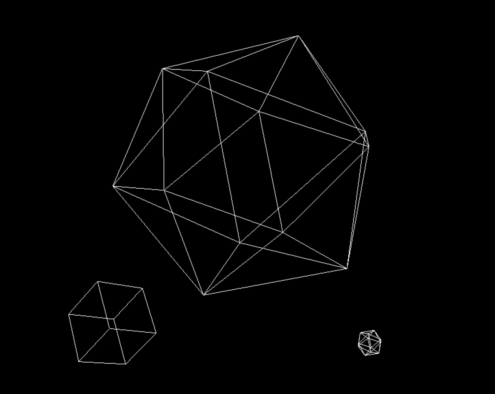

# AstroSim: 3D Orbit Simulation in Python

AstroSim is a work-in-progress 3D simulation of astronomical objects of different sizes, built with Python, pygame, and OpenGL. The goal is to watch several objects orbit one another in real time. This is a learning project: I started it to learn Python and to explore the physics of orbital motion, which connects to my interest in astronomy and optics.

<!-- Add a screenshot of the current rendering here, and replace it with a GIF of the orbits once they work. -->


## Project Status

**In progress.** Objects of different sizes can currently be created and rendered in 3D space at chosen coordinates. The attraction between objects, which makes them move and orbit, is the next piece I'm building.

## Goals

The scope of this project includes, but is not limited to:

1. Learning Python
2. Creating and using classes to represent astronomical objects of different sizes
3. Displaying these objects in 3D space using `pygame` and `OpenGL`
4. Adding a simple physics calculation that directs the momentum of the objects toward each other, based on their size, over a small time-step
5. Reaching a minimum viable product (MVP): three objects of different sizes and different initial momenta orbiting each other with imperfect but reasonably accurate physics (collisions not included)

## Current Features

- Object-oriented design: astronomical objects are created from a Python class, so objects of different sizes are easy to add.
- 3D rendering of objects at specified coordinates using `pygame` and `OpenGL`.

## Planned Features

- **Attraction between objects:** at each small time-step, each object's momentum is adjusted toward the others based on their sizes, and positions are updated from the new momentum. This is the MVP physics.
- **More accurate gravity:** after the simple attraction works, I plan to replace it with a more accurate gravity formula.
- **Camera controls:** rotating and zooming the view, which will also make it easier to test and debug the physics.
- **Collisions:** handling objects that meet or overlap (not part of the MVP).

## How the Simulation Will Work

1. Each object is created with a size and an initial momentum.
2. At every time-step, the simulation calculates the pull between each pair of objects based on their sizes and the distance between them.
3. Each object's momentum is updated from that pull, and its position is moved accordingly.
4. The updated positions are drawn on screen, and the process repeats.

Because the simulation moves objects in discrete time-steps rather than solving the motion exactly, small errors build up over time. This is why the first version is expected to be reasonably accurate but not perfect. Smaller time-steps give more accurate results.

## Getting Started

### Requirements

- Python 3.15.2
- `pygame`
- `PyOpenGL`
- `numpy`

### Installation

```bash
git clone https://github.com/SohamMayani/AstroSim.git
cd AstroSim
pip install pygame PyOpenGL numpy
```

### Running the program

```bash
python main.py
```

## What I'm Learning

- Python fundamentals, including writing and using classes
- Modeling real objects as classes with their own properties and behavior
- Rendering 3D graphics with `pygame` and `OpenGL`
- Turning a physical idea (attraction between objects) into a step-by-step numerical calculation

## Author

Soham Mayani
[LinkedIn](https://www.linkedin.com/in/sohammayani)
